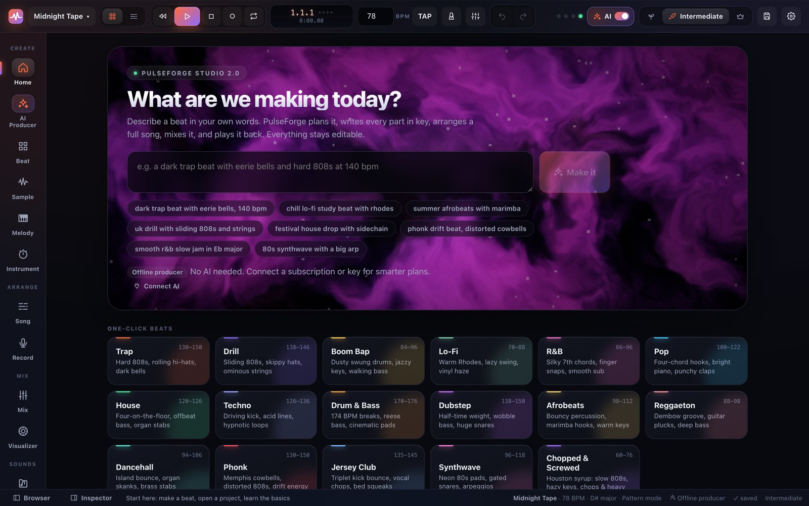
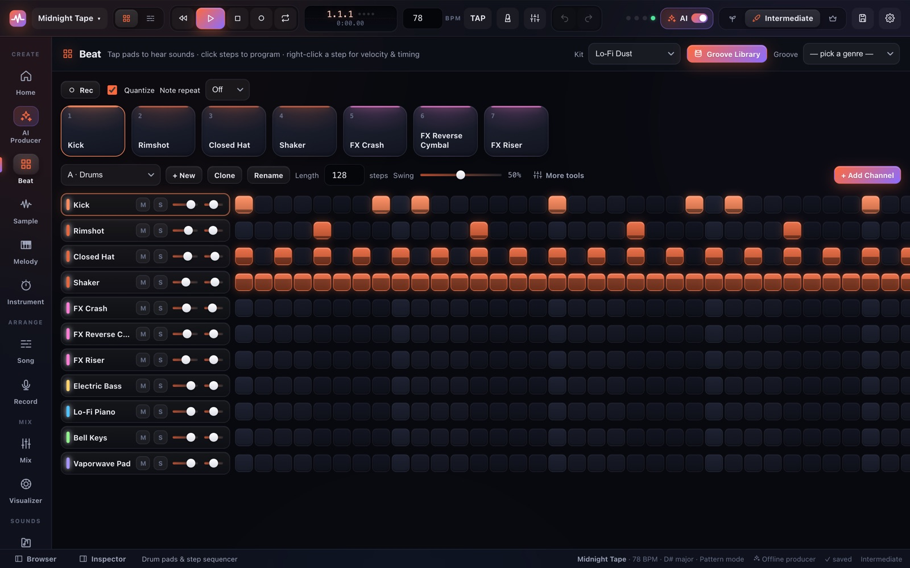
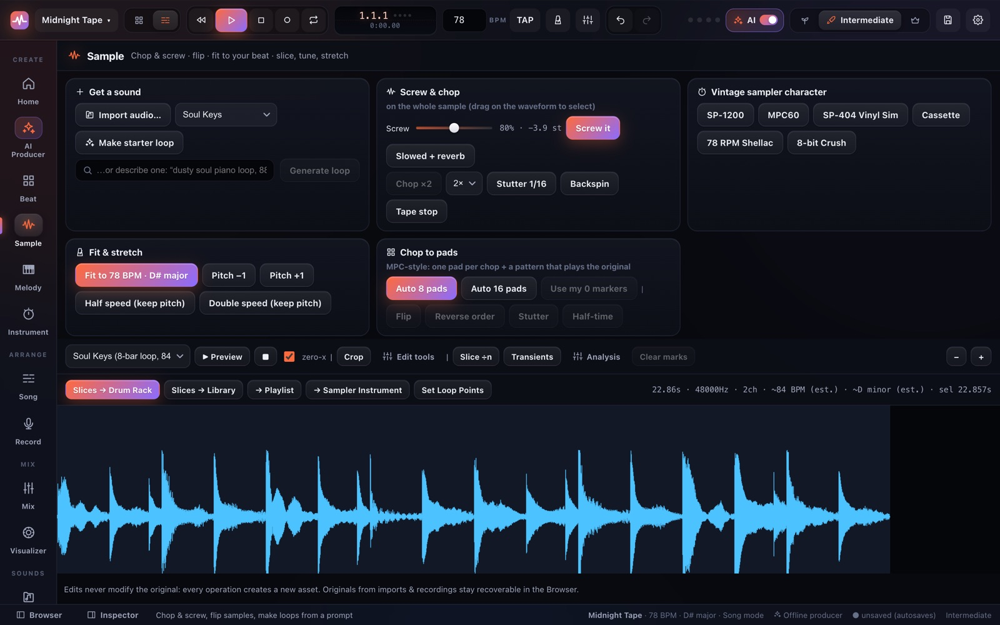
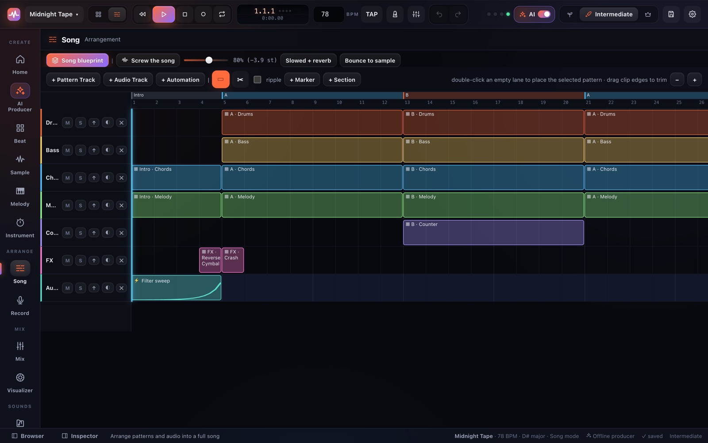
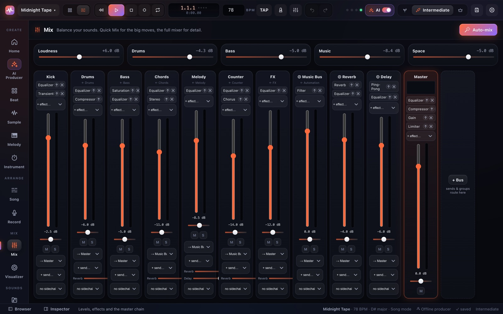
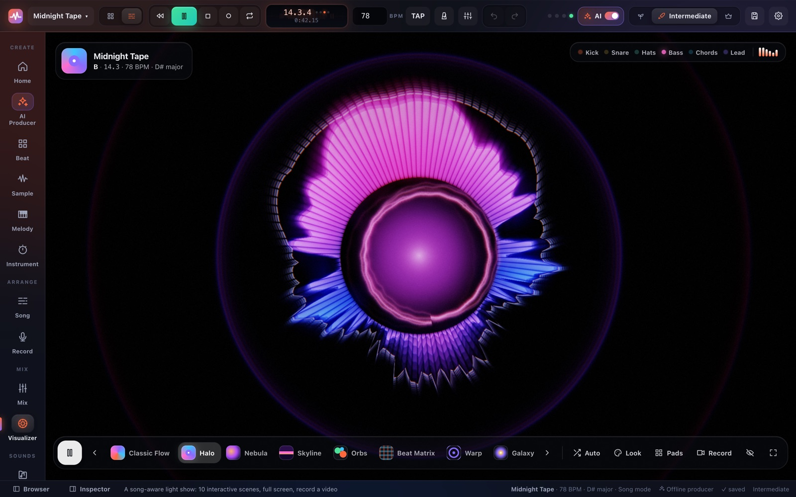
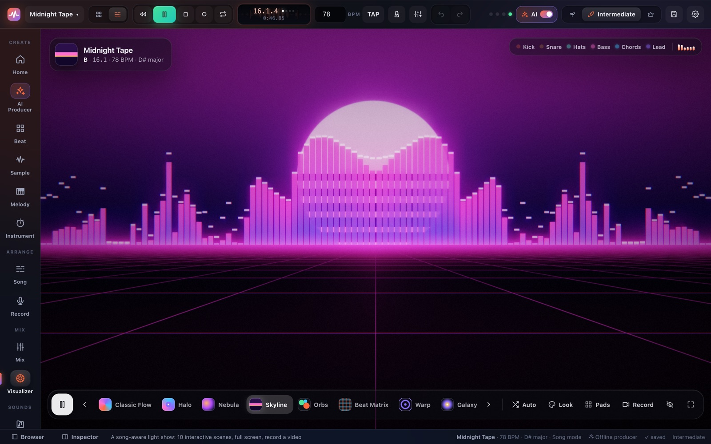
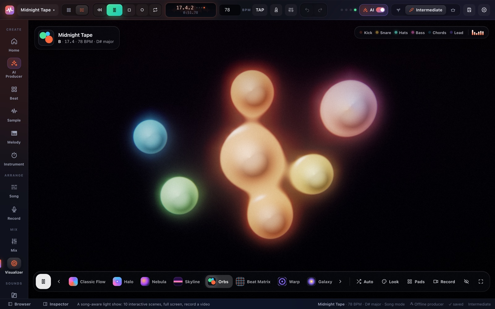
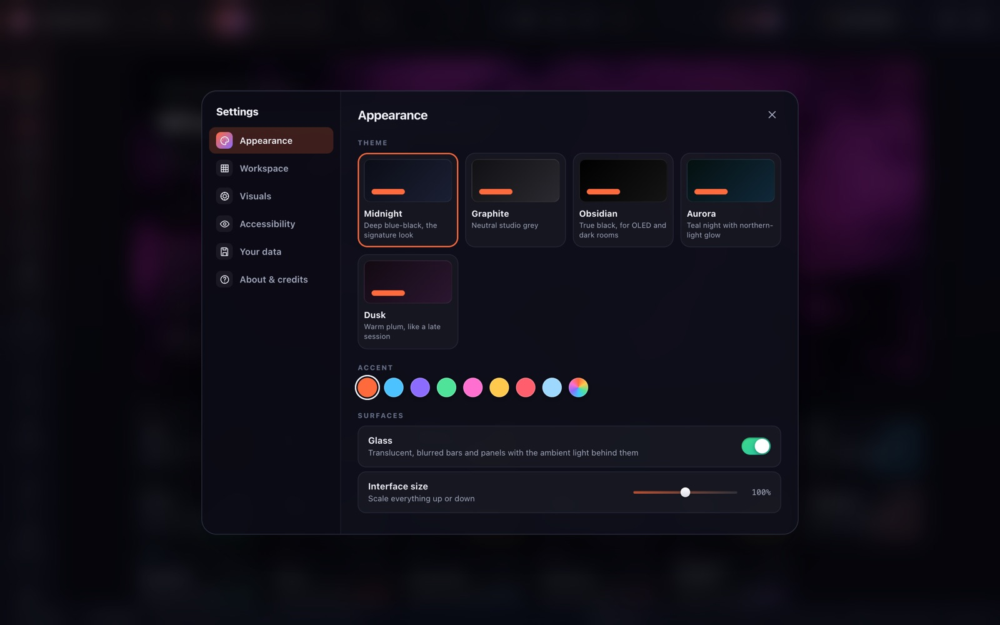
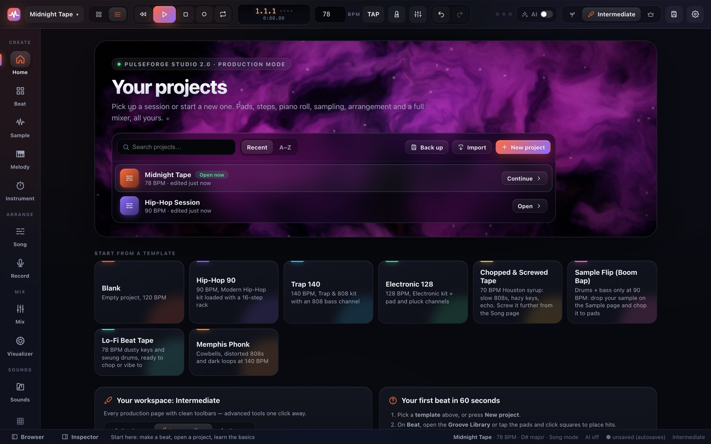

# PulseForge Studio ⚒

### Your whole beat studio in a browser tab. Pads, piano roll, sampler, mixer, a light show, and an AI producer you can switch off whenever you just want to cook.

**▶ [Open the web studio](https://pulseforge-studio-app.vercel.app)** &nbsp;·&nbsp; **🍎 [Download the Mac app](https://github.com/CartyChris/PulseForge_Studio/releases/latest)** &nbsp;·&nbsp; **📖 [Your first song](GETTING_STARTED.md)**

---

## What's in the box 🎛️

Type *"dark trap beat with eerie bells, 140 bpm"* and hear a finished, mixed song a few seconds later.
Or ignore the robots entirely and build every hit yourself. Either way, everything stays editable.

| | |
|---|---|
|  | **🥁 Beat:** MPC-style pads (keys 1–8), live **Rec** with **Note Repeat**, a step sequencer lit in each instrument's colour, and a **68-groove library** (boom bap, Dilla swing, drill, Memphis, dembow, amapiano and more). 22 drum kits, one-click genre grooves, swing, humanize, Euclidean rhythms. |
| **🔪 Sample · chopped & screwed:** import anything (or make a royalty-free starter loop), then **Screw it**, chop, stutter, backspin, tape-stop, slowed + reverb. Give it an **SP-1200 / MPC60 / SP-404 / cassette** character, **fit it to your tempo and key**, and **chop it to 8 or 16 pads** with flips. |  |
|  | **🎼 Melody & Song:** a piano roll with **48 chord progressions** spelled in your key, 118 instrument presets (real sampled piano and orchestra, FM, supersaws, 808s), and an arrangement view with **song blueprints** that grow one loop into intro → verse → hook → outro. |
| **🎚️ Mix:** Quick-Mix sliders for beginners, a full mixer for everyone else. 26 effects, sends, buses, sidechain ducking, a mastering chain and a measured **Auto-mix**. Export WAV, stems or MIDI. |  |

### 🌈 A visualizer that actually listens to *your* song

The old iTunes visualizer, but it reads your patterns: every kick, snare, hat, bass note and chord lands
**exactly** on the beat, colours come from your song's key, and the **Orbs** scene turns each instrument
into a glowing blob in its own colour. Ten GPU scenes, Auto mode that changes with your song's sections,
performance pads, full screen, and **record a video with audio** for socials.

 
 

### 🧠 AI when you want it. 🔌 Off when you don't.

- **AI Producer:** one sentence → plan, compose, arrange, mix, review. Works **offline** with the built-in
  producer, and gets smarter with your **Claude Code, Codex, Kimi or Grok** subscription, an API key, or an
  OpenRouter sign-in. Ask for a full song, a loop to sample, or a stem pack.
- **Flip the ✨ AI switch off** and PulseForge becomes a pure production studio: no AI pages, no prompts,
  nothing sent anywhere. Home turns into your project shelf.

### 🙂 As simple or as deep as you like

**Beginner · Intermediate · Expert** decides how much is on screen (never what the studio can do), and
**Customize** lets you build your own workspace, from a four-page beat station to the full studio.
Five themes, any accent colour, glass or solid surfaces, reduced motion.

### 💾 Your music stays yours

- **Saved in your browser, on your device.** Projects and audio live in this browser's storage (IndexedDB + OPFS),
  never on a server. **Autosave** runs as you work and flushes the instant you switch tabs or close the window.
- **Protected storage:** the studio asks the browser to keep your data so it isn't cleared to free space.
  Check it any time in **Settings → Your data**.
- **Export everything:** **Back up everything** downloads every project and its audio as one `.pfbackup` file
  that restores in any browser or the Mac app (and never overwrites newer work). Single projects export as
  `.pfproj`; songs as **WAV**, **stems** or **MIDI**.
- **Install it:** in Chrome or Edge, use *Install PulseForge Studio* from the browser menu to get it in its own window.
- **Bring your own key:** on the hosted site, any API keys you add stay in your browser and travel only with your own requests.

> **Safari users:** Safari can delete website data after seven days without a visit, so keep a recent
> backup (⌘K → *Back up all projects*) or use the Mac app.

---

## Three ways to run it

| | How | Notes |
|---|---|---|
| **Mac app** | download the `.dmg` from [Releases](https://github.com/CartyChris/PulseForge_Studio/releases/latest), drag to Applications | Electron, Apple Silicon. Finds your installed AI CLIs automatically. Microphone prompt on first record. |
| **Local browser** | double-click `Start PulseForge.command`, or `npm install && npm run start` | Serves studio + API on http://127.0.0.1:7800 |
| **Web (hosted)** | **https://pulseforge-studio-app.vercel.app**, or deploy your own: [Deploying to Vercel](#deploying-to-vercel) | Bring-your-own-key: each visitor's keys stay in their own browser |

**First launch of the Mac app:** it's signed ad-hoc, not notarized by Apple, so macOS says it can't
verify the developer. Click **Done**, then open **System Settings → Privacy & Security**, scroll to the
PulseForge message and click **Open Anyway** (once). Rebuild it any time with `npm run build:desktop`.

## Beginner · Intermediate · Expert

Pick a level on first launch, or switch any time from the top bar. **Nothing is ever removed**:
the level only decides how much is on screen at once.

- **Beginner**: Home, AI Producer, Beat (drum pads + steps), Sample, Melody, Song, Record, Mix (Quick Mix
  sliders + Auto-mix), Visualizer, Sounds, Connect. Big controls, coach tips, simple toolbars.
- **Intermediate**: adds Instrument, Audio editor, Sound Lab and AI Chat pages, the sound browser /
  inspector panels, and the everyday power tools (tap tempo, snap, ghost notes, humanize, routing…).
  Rarely used tools sit behind a **More tools** button.
- **Expert**: everything at once: both side panels open, dense toolbars, time signature and count-in
  in the top bar, every generator and editor.

**AI on / off** (the ✨ AI switch next to the level, or Settings → Workspace): turn AI off and PulseForge
becomes a pure beat-making and production studio — no AI Producer, AI Chat, Sound Lab, Connect page or
prompts, and nothing is sent anywhere. Home becomes your project shelf (search, open, duplicate, import,
new from a template). Turn it back on any time; nothing is lost.

**Customize** (bottom of the nav rail, or Settings → Workspace) goes further: pick a workspace —
*Just make beats* (4 pages), *Beat maker*, *Songwriter*, *Full studio* — or switch any section on or off.
Hidden sections stay one ⌘K away.

⌥1…⌥9 jumps between the sections you can see, ⌘K searches every action, `?` shows all shortcuts.

## Look & feel

A glass interface over a live ambient light that breathes with your kick and bass. **Settings → Appearance**:
five themes (Midnight, Graphite, Obsidian, Aurora, Dusk), any accent colour, glass on/off, interface size.
**Settings → Accessibility**: reduce motion, reduce transparency.

## Visualizer

A song-aware light show in the spirit of the old iTunes visualizer. It reads the song, not just the
volume: kick, snare, hat, bass, chord and lead hits come straight from your patterns, so they land
exactly on the beat. Colours come from the song's key; the Beat Matrix scene shows your actual pattern;
the Orbs scene turns each instrument into a liquid orb in its channel colour.

- **10 GPU scenes**: Classic Flow, Halo, Nebula, Skyline, Orbs, Beat Matrix, Warp, Galaxy, Kaleido,
  Phosphor. **Auto** changes scene with the song's sections and energy.
- **Interactive**: move to bend the light, click for a shockwave, scroll for intensity; **Pads** (keys
  1–8) hit drums and visuals together; ← → change scene, F full screen, H hides the controls.
- **Record** saves a video of the visualizer with your song's audio (WebM) for socials.
- **Look**: colour from the song key, your instruments, the studio accent, a spectrum cycle or mono;
  intensity, speed, trails, glow, grain, lens split, render quality (levels show more of these).
- Around the studio: a live spectrum LCD in the top bar (click it to open the Visualizer) and a live
  scene behind the Home prompt. Toggle these in **Settings → Visuals**.

## Making a beat in 60 seconds

1. On **Home**, click a genre tile (Trap, Drill, Afrobeats, Lo-Fi, Chopped & Screwed… 17 genres) or describe a beat:
   *"dark trap beat with eerie bells and hard 808s, 140 bpm"*.
2. The **AI Producer** plans it (genre, tempo, key, chords, form, sounds), writes every part in key,
   builds the session on real mixer tracks, then renders a test section and adjusts loudness and tone
   until it measures right. Every step is undoable.
3. Not quite right? Type *"faster"*, *"darker"*, *"more swing"*, *"no melody"* or *"another version"*.
4. Open **Beat** to tap pads (keys 1–8) and edit the drum steps, **Melody** for the piano roll,
   **Song** for the arrangement, **Mix** for levels.
5. **Project ▾ → Export…** renders a WAV (16/24/32-bit, 44.1–96 kHz, optional stems).

## Commands

| Command | What it does |
|---|---|
| `npm run dev` | Vite dev server on :7800 + backend API on :7801 (hot reload) |
| `npm run build` | Production build into `dist/` |
| `npm run start` | Build (if needed) + serve studio & API on one port (7800) |
| `npm run build:desktop` | Build the Mac app → `release/*.dmg` (Electron) |
| `npm run desktop:dev` | Run the Electron shell against a fresh build, unpackaged |
| `npm run lint` | ESLint over the sources |
| `npm run typecheck` | Strict TypeScript on frontend + backend |
| `npm run test` | Vitest unit + integration suites (343 tests) |
| `npm run test:e2e` | Playwright end-to-end suite (real audio engine) |
| `npm run verify` | lint + typecheck + test + build + e2e, in order |

## What's inside

- **Drums**: 22 kits (808, 909, boom bap, trap, drill, house, techno, afrobeats, reggaeton, phonk,
  jersey club, drum & bass, dancehall, lo-fi, R&B, pop, 80s, dubstep, world percussion…), each with
  30 roles: kicks, snares, claps, snaps, hats, percussion, congas, bongos, clave, cowbell, vox "hey",
  risers and reverse cymbals. Plus 76 factory one-shots (FX, stabs, orchestra hits, vinyl textures).
- **Instruments**: 118 presets over 31 engines: subtractive/FM/supersaw/organ/string/brass synths, 808
  and sub basses, plus real sampled grand piano (Salamander, CC BY 3.0) and orchestra (VSCO 2 CE,
  CC0): strings, pizzicato, harp, woodwinds, brass, mallets, guitars.
- **AI Producer**: one sentence → planned, composed, arranged, mixed track; revisions in plain
  English; optional AI producer review with safe, undoable mixer fixes. Uses the first AI that
  answers (your CLI subscriptions first) and falls back to the offline producer.
- **Connections**: installed AI CLIs are detected and used in answer-only mode (tools off, empty
  sandbox folder, your existing login; tokens are never read). 27 providers: Anthropic, OpenAI, Gemini,
  OpenRouter (one-click OAuth sign-in), xAI, Moonshot/Kimi, Z.ai GLM (API and Coding Plan), DeepSeek,
  Mistral, Groq, Together, Ollama, LM Studio, any OpenAI- or Anthropic-compatible endpoint, plus
  ElevenLabs and Fish Audio for audio.
- **Sampling, chopped & screwed** (Sample page, in every level): **Screw** (tape slow-down), **Chop**
  (DJ Screw-style repeat), **Stutter**, **Backspin**, **Tape stop**, **Slowed + reverb**; vintage sampler
  characters (**SP-1200, MPC60, SP-404 vinyl, cassette, 78 rpm, 8-bit**); **time-stretch without pitch change**,
  **pitch-shift without tempo change**, and **Fit to project** (detects the sample's tempo and key and
  matches your beat). **Chop to pads** (MPC-style: 8/16 pads snapped to the hits, plus a pattern that replays
  the original), then **Flip / Reverse / Stutter / Half-time** the chops. Screw or slow your *whole song* from
  the Song page.
- **Prompt → audio**: on the AI Producer (or in AI Chat's *Create audio* mode) ask for a **full song**, an
  **8-bar loop/sample** or a **stem pack** (drums, bass, chords, melody). They render straight into your library,
  tagged with tempo and key, without touching your project. Uses your connected AI to plan, works offline too.
- **Presets to start fast**: **68-groove library** (boom bap, Dilla swing, trap rolls, drill, Memphis, Houston
  screw, dembow, amapiano, UK garage, footwork, jungle…), **48 chord progressions** by mood spelled in your key,
  **11 song blueprints** that turn one loop into a full arrangement, **12 royalty-free sample starters** to chop,
  and starter projects (Chopped & Screwed Tape, Sample Flip, Lo-Fi Beat Tape, Memphis Phonk).
- **Beat pads**: live **Rec** into the pattern (quantized or with your feel) and MPC-style **Note Repeat**
  (1/4 to 1/32, triplets); chop pads appear next to the drum pads.
- **Free sampling resources**: curated legal sources (Freesound, Philharmonia Orchestra, Wikimedia Commons,
  ccMixter, Openverse, VSCO 2…) with each site's terms, plus a plain-English "sampling legally" guide.
- **Mixer**: 26 effect types, sends, buses, sidechain ducking, master chain with drive → limiter
  and a safety clipper (exports can't clip), Quick Mix sliders and a measured Auto-mix.
- **Recording studio**: input selection, metering, monitoring with feedback warnings, count-in,
  punch in/out, loop recording, take lanes with comping, latency calibration, vocal chain presets.
- **Audio editor**: trim, split, slice (equal/transient), normalize, fades, reverse, pitch, stretch,
  BPM/key estimate, PulseTune pitch correction, send slices to pads / sampler / song.
- **Sound packs**: Resource Hub with curated royalty-free sources, ZIP/folder importer with
  path-traversal protection, tagging, favorites. See `SAMPLE_PACK_GUIDE.md`.

## Deploying to Vercel

The repo is Vercel-ready (`vercel.json` + `scripts/build-vercel.mjs`, which bundles `api/index.ts` into one
function with esbuild): the studio is served as static files and
the backend runs as one serverless function.

1. Push this folder to a Git repo and **Import** it in Vercel (framework preset: *Other*; the build
   settings come from `vercel.json`). Or from a terminal: `npx vercel deploy --prod`.
2. No environment variables are needed. The hosted build is **bring-your-own-key**: visitors paste
   their own keys (or sign in to OpenRouter) on the Connect page. Keys stay in that visitor's
   browser and travel only with their own requests; server-side keys are ignored unless you
   deliberately set `PF_ALLOW_SERVER_KEYS=1` (don't, on a public site).
3. Desktop-only features say so politely on the hosted build: AI CLI subscriptions, local models,
   stem separation and pack downloads need the Mac app or a local run.

## Keyboard shortcuts

Space play/pause · ⌘Z undo · ⌘⇧Z redo · ⌘S save · R record tab · M metronome ·
⌘A select all · ⌘D duplicate · Delete remove · P pencil · B select tool ·
⌘K command palette · +/− zoom · arrows nudge (⇧↑/⇧↓ octave) · Esc cancel.
Shortcuts never fire while you're typing in a text field.

## iPhone / iPad

The UI adapts below 760 px (stacked transport, larger touch targets, hidden side
panels) and audio unlocks on first tap. To open the studio from a phone on your
network: `PF_HOST=0.0.0.0 npm run start`, then visit `http://<your-mac-ip>:7800`.
Note: microphone recording requires a secure context (HTTPS or localhost), so
record on the Mac or behind a HTTPS tunnel. See `TROUBLESHOOTING.md`.

## Documentation

`ARCHITECTURE.md` · `ACCEPTANCE_MATRIX.md` · `VERIFICATION_REPORT.md` ·
`AI_PROVIDER_GUIDE.md` · `AI_API_REFERENCE.md` · `SAMPLE_PACK_GUIDE.md` ·
`BUNDLED_AUDIO_LICENSES.md` · `AI_OS_INTEGRATION_GUIDE.md` · `XCODE_WRAPPER_GUIDE.md` ·
`SECURITY.md` · `TROUBLESHOOTING.md` · `WORKLOG.md`
